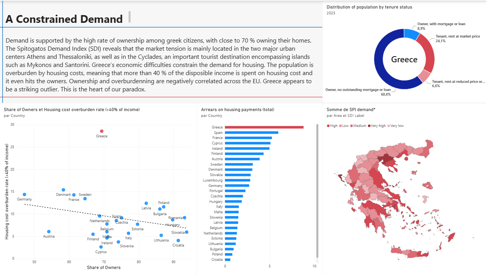
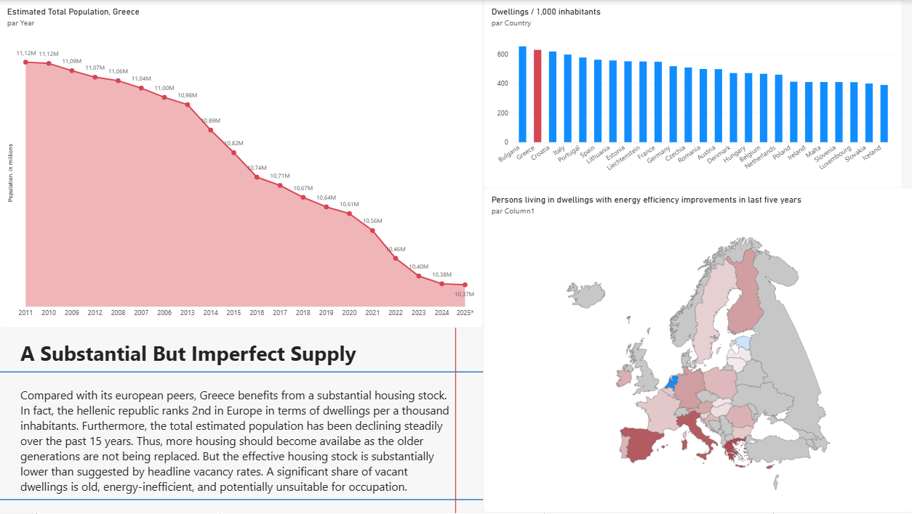
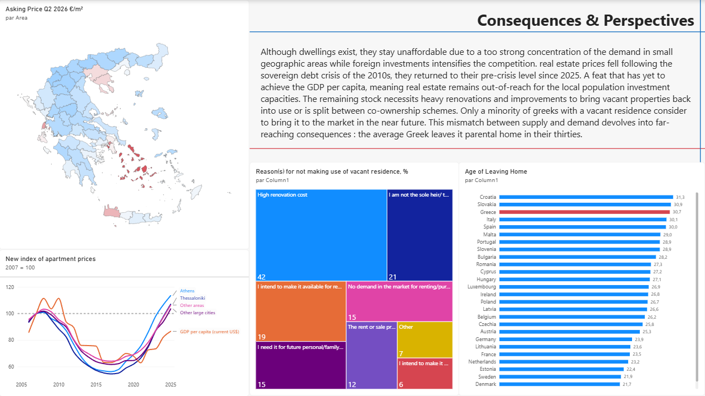

## ⚠ Disclaimer

This project was originally made on Power BI. The next slides are only a preview of the related dashboard, without all the interactive features.

---
{{data-background-image="slide_1.png"}}

---

# 

---

---

---

## References
- Eurostat
- Spitogatos.gr
- Elstat
- Bank of Greece
- Alpha Bank

---
